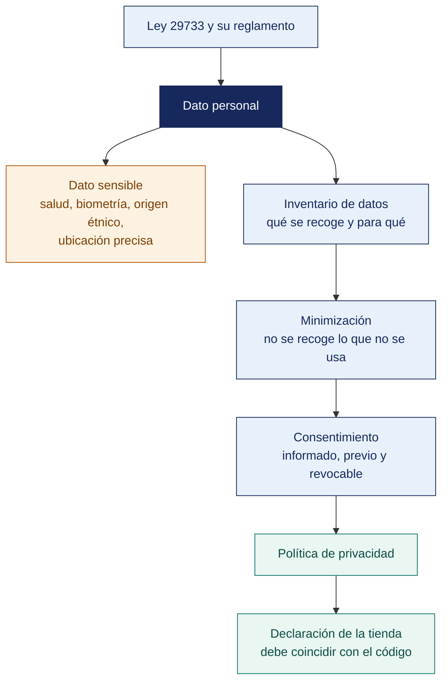

[Semana 09](README.md) · **Teoría** · [Dinámica de aula](2-DINAMICA.md) · [Taller de laboratorio](3-TALLER.md)

# Teoría · Manejo de Datos Sensibles · Privacidad por Diseño

**SI-988 · Soluciones Móviles II** · Semana 09 · Sesión 1 en aula · 2 horas académicas, 100 min, con la dinámica incluida

> ¿Un término no le resulta claro? Está definido en el [glosario técnico del curso](../GLOSARIO.md).

---

## La pregunta de esta sesión

Una app registra la ubicación del usuario cada quince minutos para ordenar locales por cercanía. No pide datos de salud, no pregunta por religión ni por afiliación sindical.

Con dos semanas de ese registro se puede saber en qué clínica se atiende esa persona, a qué templo va los domingos y en qué local sindical estuvo el martes. La app no recoge datos sensibles y los produce.

> **¿Puede una app tratar datos sensibles sin haberlos pedido nunca?**

> **Exploración (5 min), antes de cualquier definición.** El aula responde antes de la teoría y se anota. *¿Trata esa app datos sensibles? ¿Quién responde si se filtran? ¿Qué habría que cambiar para que el problema desaparezca?* No se corrige nada todavía.

## Mapa de la sesión

---

## 1. Qué es un dato personal y qué lo hace sensible

> **¿Qué convierte un dato inocuo en un dato sensible?**

**La definición operativa.** Un **dato personal** es cualquier información sobre una persona natural **identificada o identificable**. La clave es la segunda palabra. Un dato que por sí solo no identifica puede hacerlo **combinado con otro**.

| Parece anónimo | Por qué no lo es |
|---|---|
| Identificador de dispositivo | Identifica de forma persistente a una persona |
| Ubicación aproximada por hora | La combinación de dónde duerme y dónde trabaja identifica a casi cualquiera |
| Modelo de teléfono + operador + versión del sistema | En conjunto, muy pocos usuarios comparten esa combinación |
| Dirección IP | Se considera dato personal en la mayoría de los marcos |
| Correo con formato `nombre.apellido@empresa.pe` | Identifica directamente |

**Categorías especiales — los datos sensibles.** En el marco peruano, la **Ley 29733** define como sensibles los datos biométricos, el origen racial y étnico, los ingresos económicos, las opiniones políticas, las convicciones religiosas o filosóficas, la afiliación sindical, y la información relacionada con la salud y la vida sexual.

| Dato sensible | Dónde aparece en una app móvil |
|---|---|
| **Biométricos** | Huella, rostro, voz. **Nota importante**: la autenticación biométrica del sistema **no entrega la huella a la app**; solo confirma si coincidió. Eso reduce drásticamente el riesgo |
| **Salud** | Apps de bienestar, síntomas, medicación, actividad física |
| **Ingresos económicos** | Apps financieras, de crédito, de subsidios |
| **Ubicación con inferencia** | Visitas repetidas a un centro de salud, a un templo o a una sede sindical **infieren** un dato sensible |

> **La inferencia es el riesgo que casi ningún equipo evalúa.** Una app que registra ubicación cada 15 minutos no recoge datos de salud, pero **puede inferirlos**. Ante la normativa, el resultado es equivalente.

> **El error frecuente del bloque.** Evaluar cada dato por separado. La clave de la definición es «identificable», y **un dato que por sí solo no identifica puede hacerlo combinado con otro**. La inferencia es el riesgo que casi ningún equipo evalúa, y ante la normativa el resultado es equivalente a haber recogido el dato sensible.

## 2. El marco normativo aplicable

> **¿Qué le exige a esta app la normativa peruana vigente?**

| Marco | Cuándo aplica a la app | Obligaciones principales |
|---|---|---|
| **Ley 29733 y D. S. 016-2024-JUS** (Perú) | **Siempre** que trate datos de personas naturales | Base legal, consentimiento previo, expreso, informado e inequívoco; finalidad determinada; proporcionalidad; medidas de seguridad; derechos ARCO; garantías para el flujo transfronterizo |
| **RGPD** (Unión Europea) | Si la app se ofrece a personas en la UE o monitorea su comportamiento | Base jurídica, minimización, privacidad por diseño y por defecto, portabilidad, derecho al olvido, notificación de brechas en 72 h |
| **Políticas de Google Play** | Al publicar | Política de privacidad accesible, sección de **seguridad de los datos** completa y veraz, permisos justificados |
| **Políticas de la App Store** | Al publicar | **Etiquetas de privacidad** («nutrition labels»), política de privacidad, transparencia en el seguimiento |

**El Reglamento peruano vigente.** El **D. S. 016-2024-JUS**, en vigor desde el **31 de marzo de 2025**, reemplazó al reglamento anterior y elevó considerablemente el nivel de exigencia — 135 artículos que desarrollan el consentimiento, las medidas de seguridad, los encargados del tratamiento y el flujo transfronterizo. La autoridad de control es la **Autoridad Nacional de Protección de Datos Personales (ANPD)**.

**Los siete principios que ordenan el diseño.**

| Principio | Qué exige | Traducción a decisión de diseño |
|---|---|---|
| **Legalidad** | Base legal para tratar el dato | Antes de recoger un dato, ¿con qué derecho? |
| **Consentimiento** | Previo, expreso, informado e inequívoco | Nada de casillas premarcadas ni consentimiento tácito |
| **Finalidad** | Determinada, explícita y lícita | Cada dato recogido tiene un para qué declarado |
| **Proporcionalidad** | Adecuado, relevante y **no excesivo** | **Minimización**: si no es necesario, no se recoge |
| **Calidad** | Exacto, actualizado y conservado el tiempo necesario | Política de retención y de depuración |
| **Seguridad** | Medidas técnicas, organizativas y legales | Cifrado, control de acceso, registro |
| **Disposición del recurso** | Vías para ejercer los derechos ARCO | Pantalla de privacidad en la app |

> **El error frecuente del bloque.** Suponer que basta con la Ley 29733. El reglamento vigente es el D. S. 016-2024-JUS, en vigor desde el 31 de marzo de 2025, y **elevó considerablemente el nivel de exigencia** con 135 artículos sobre consentimiento, medidas de seguridad, encargados del tratamiento y flujo transfronterizo.

## 3. Privacidad por diseño en siete decisiones

> **¿Cuál de las siete decisiones elimina el problema en lugar de mitigarlo?**

**Privacidad por diseño** significa que la protección se incorpora en la arquitectura, no se agrega después. Las siete decisiones que un equipo móvil debe tomar:

| # | Decisión | Pregunta | Alternativa que protege |
|---|---|---|---|
| **1** | **¿Recoger o no?** | ¿La app funciona sin este dato? | No recogerlo. Es la medida más eficaz |
| **2** | **¿Cuánta precisión?** | ¿Basta la ciudad en lugar de la coordenada exacta? | Recoger el nivel mínimo que resuelve el caso |
| **3** | **¿Dónde procesarlo?** | ¿Puede procesarse en el dispositivo? | **Procesamiento local**: el dato nunca sale |
| **4** | **¿Cuánto conservarlo?** | ¿Sirve después de 30 días? | Retención definida y **depuración automática** |
| **5** | **¿Identificado o agregado?** | ¿Se necesita saber quién, o basta cuántos? | Agregación o seudonimización |
| **6** | **¿A quién se envía?** | ¿Este servicio de análisis necesita este dato? | Reducir terceros; **cada uno es un encargado del tratamiento** |
| **7** | **¿Qué pasa si se filtra?** | ¿Cuál es el daño para la persona? | Determina el nivel de protección exigible |

> **La decisión 3 es la más poderosa y la más ignorada.** Un dato procesado en el dispositivo y nunca transmitido **no puede filtrarse desde el servidor, no requiere garantías de flujo transfronterizo y no aparece en la etiqueta de privacidad de la tienda.** La biometría del sistema es el ejemplo perfecto. La app nunca ve la huella.

**El consentimiento — cómo se pide bien.**

| Requisito | Implementación correcta | Implementación inválida |
|---|---|---|
| **Previo** | Antes de recoger el dato | Recoger y luego avisar |
| **Expreso** | Acción afirmativa del usuario | **Casilla premarcada**, o «al continuar aceptas» |
| **Informado** | Se explica qué, para qué, quién y por cuánto tiempo | Enlace a un documento de 20 páginas |
| **Inequívoco** | Sin ambigüedad sobre a qué se consintió | Un solo botón para diez finalidades |
| **Granular** | Consentimiento **separado por finalidad** | Todo o nada |
| **Revocable** | Tan fácil de retirar como de dar | Escribir un correo para darse de baja |
| **Demostrable** | Se registra qué se consintió, cuándo y en qué versión del texto | Sin registro |

**Los derechos ARCO** —la app debe ofrecer una vía para ejercerlos:

| Derecho | Qué debe permitir la app |
|---|---|
| **Acceso** | Ver qué datos suyos tiene la organización, y descargarlos |
| **Rectificación** | Corregir un dato inexacto |
| **Cancelación** | **Eliminar la cuenta y sus datos.** Ambas tiendas lo exigen si la app permite crear cuenta |
| **Oposición** | Oponerse a un tratamiento concreto, como el análisis de uso |

> **La eliminación de cuenta desde la app es requisito de ambas tiendas.** No basta con un formulario web escondido. Debe ser accesible desde la propia aplicación.

> **El error frecuente del bloque.** Agregar la privacidad al final, sobre una arquitectura ya construida. Privacidad por diseño significa incorporarla en la arquitectura, y su decisión más poderosa es procesar en el dispositivo — **un dato que nunca se transmite no se filtra desde el servidor, no exige garantías de flujo transfronterizo y no aparece en la etiqueta de la tienda**.

## 4. Las declaraciones de las tiendas

> **¿Responde el equipo por lo que recogen sus dependencias?**

Ambas tiendas exigen declarar públicamente qué datos recoge la app y para qué. **La declaración debe coincidir con lo que la app hace**. La discrepancia es causa de rechazo o de retiro.

| Aspecto a declarar | Google Play | App Store |
|---|---|---|
| Qué datos se recogen | Sección de seguridad de los datos | Etiquetas de privacidad |
| Si se comparten con terceros | Sí, con detalle | Sí, con detalle |
| Si se usan para seguimiento entre apps | Sí | Sí, y requiere permiso del usuario |
| Si se cifran en tránsito | Declaración obligatoria | Implícito en las prácticas |
| Si el usuario puede solicitar la eliminación | **Obligatorio declararlo** | Obligatorio |
| Política de privacidad | URL obligatoria y accesible | URL obligatoria |

> **La trampa de las bibliotecas de terceros.** Un SDK de análisis, de publicidad o de reporte de errores **recoge datos por su cuenta**. El equipo debe **auditar qué recoge cada dependencia** y declararlo. **Desconocerlo no exime.** El responsable ante la autoridad y ante la tienda es quien publica la app.

**Ejemplo trabajado — el inventario de datos de la app del menú, y la declaración que resulta.** Se recorre cada dato con las siete decisiones antes de escribir la sección de seguridad de los datos.

| Dato | ¿Se necesita? | Precisión mínima | Dónde se procesa | Retención | Se declara como |
|---|---|---|---|---|---|
| Correo del usuario | Sí, para recuperar la cuenta | — | Servidor | Hasta que elimine la cuenta | **Recogido**, no compartido |
| Locales que sigue | Sí, es la función | — | Servidor | Hasta que elimine la cuenta | **Recogido**, no compartido |
| Ubicación | Sí, para ordenar por cercanía | **Aproximada basta** | **Solo en el dispositivo**. Se ordena localmente y **no se envía** | No se almacena | **No recogido** |
| Token de notificaciones | Sí, para avisar del menú | — | Servidor | Mientras la app esté instalada | **Recogido**, no compartido |
| Identificador de publicidad | **No** | — | — | — | **No se usa**. Se elimina el SDK que lo pedía |
| Fallos y trazas | Sí, para corregir errores | Sin identificador de usuario | Servicio de reporte de errores | 90 días | **Recogido y compartido** con el proveedor del servicio |

**La auditoría de dependencias, que es donde aparecen las sorpresas.**

| Dependencia | Qué recoge por su cuenta | Decisión |
|---|---|---|
| Biblioteca de mapas (MapLibre + teselas OSM) | La IP en cada petición de tesela | Se conserva; se declara el uso del proveedor de teselas |
| SDK de análisis de uso | Identificador de publicidad, modelo, operador, eventos | **Se retira.** Las métricas del Lean Canvas se obtienen sin identificar |
| SDK de reporte de errores | Traza, versión, modelo; **y el correo si se configura mal** | Se conserva, **desactivando el envío de datos del usuario** |
| Biblioteca de imágenes | Nada | Se conserva |

> **La fila de la ubicación es la que decide todo lo demás.** Ordenar los locales por cercanía **no exige enviar la coordenada**. El cálculo cabe en el dispositivo. Esa única decisión de arquitectura hace que la ubicación **no aparezca en la etiqueta de privacidad**, que no haya flujo transfronterizo que garantizar y que un incidente en el servidor no exponga dónde estuvo nadie. **El dato que no se recoge es el único que no hay que proteger, declarar, ni explicar tras una filtración.**

> **Microaplicación (6 min). El dato que se puede dejar de recoger.** Cada equipo recorre su inventario y señala **un dato que hoy envía al servidor y podría procesar en el dispositivo**. Ese cambio es el que desaparece de la etiqueta de privacidad.

| Caso | Qué debe contener una buena respuesta |
|---|---|
| La app no pide datos de salud. ¿Puede tratar datos sensibles igualmente? | Sí, por inferencia. Un registro de ubicación frecuente permite deducir visitas a un centro de salud o a un templo, y ante la norma el resultado es equivalente |
| ¿Basta un botón «al continuar aceptas los términos»? | No. El consentimiento debe ser expreso, granular por finalidad y demostrable. Ese patrón no es acción afirmativa ni permite saber a qué consintió |
| ¿Qué pasa si un SDK recoge más de lo declarado? | Responde quien publica la app. Es causa de rechazo o retiro de la tienda, y de responsabilidad ante la ANPD. Por eso se audita cada dependencia antes de publicar |

## Cierre

**La respuesta a la pregunta con la que abrimos.** Sí, por inferencia, y ante la autoridad el resultado es equivalente. La app del caso no pide salud ni religión ni afiliación sindical, y con dos semanas de registro las produce las tres. El arreglo no es un aviso de privacidad más largo — es **calcular la cercanía en el dispositivo y no enviar la coordenada**, con lo que el problema deja de existir.

**Las tres ideas que deben quedar.**

| Idea | Por qué importa en el ejercicio profesional |
|---|---|
| La inferencia crea datos sensibles que nadie pidió | Se evalúa el conjunto de datos, no cada dato por separado |
| El reglamento vigente es el D. S. 016-2024-JUS y exige mucho más que la ley sola | 135 artículos sobre consentimiento, seguridad, encargados y flujo transfronterizo |
| El dato que no se recoge es el único que no hay que proteger, declarar ni explicar tras una filtración | Y las dependencias de terceros recogen por su cuenta; desconocerlo no exime al que publica |

**Volviendo a la exploración del inicio.** Se releen las respuestas del inicio. La tercera pregunta se responde casi siempre cifrando o pidiendo consentimiento. Ambas cosas son necesarias y ninguna elimina el riesgo — **lo elimina no transmitir el dato**.

**Lo que sigue.** La [dinámica de esta sesión](2-DINAMICA.md) levanta el inventario de datos de la app propia, lo somete a las siete decisiones y produce la declaración de la tienda. El taller audita después qué recoge cada dependencia.

---

---

[Semana 09](README.md) · **Teoría** · [Dinámica de aula](2-DINAMICA.md) · [Taller de laboratorio](3-TALLER.md)

---

**Docente** · Dr. Oscar Juan Jimenez Flores
[oscarjimenezflores@upt.pe](mailto:oscarjimenezflores@upt.pe) · [LinkedIn](https://www.linkedin.com/in/oscar-jimenez-flores/) · [CTI Vitae — CONCYTEC](https://ctivitae.concytec.gob.pe/appDirectorioCTI/VerDatosInvestigador.do?id_investigador=33398)

Escuela Profesional de Ingeniería de Sistemas · Universidad Privada de Tacna · Tacna, Perú
