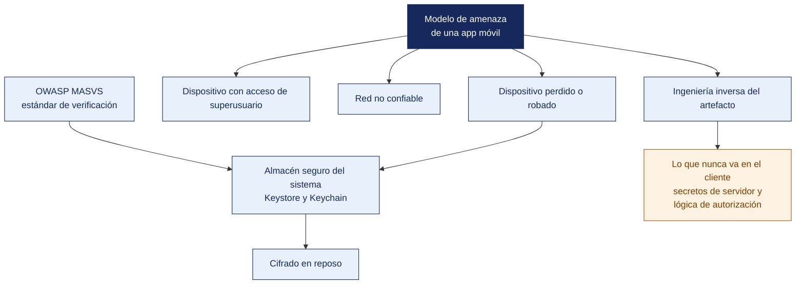

[Semana 10](README.md) · **Teoría** · [Dinámica de aula](2-DINAMICA.md) · [Taller de laboratorio](3-TALLER.md)

# Teoría · Seguridad en Aplicaciones Móviles · Cifrado y Almacenamiento Seguro

**SI-988 · Soluciones Móviles II** · Semana 10 · Sesión 1 en aula · 2 horas académicas, 100 min, con la dinámica incluida

> ¿Un término no le resulta claro? Está definido en el [glosario técnico del curso](../GLOSARIO.md).

---

## La pregunta de esta sesión

Un equipo entrega su app. Un compañero conecta el teléfono por cable, descomprime el artefacto y en diez minutos encuentra la clave de la pasarela de pago, el token de sesión en texto plano y la base de datos local sin cifrar.

Ninguno de los tres es un fallo exótico. Los tres son atajos del sprint 1 que nadie volvió a mirar.

> **¿Qué puede leer de su app alguien que tenga el teléfono en la mano?**

> **Exploración (5 min), antes de cualquier definición.** El aula responde antes de la teoría y se anota. *¿Cuál de los tres hallazgos es el más grave? ¿Se arregla ofuscando el código? ¿Dónde debería vivir la clave de la pasarela?* No se corrige nada todavía.

## Mapa de la sesión

---

## 1. El modelo de amenaza de una app móvil

> **¿Quién controla el dispositivo en el que corre su app?**

**La premisa que cambia todo.** En una aplicación móvil, **el atacante controla el dispositivo**. El artefacto está en sus manos, puede descompilarlo, inspeccionar su almacenamiento, interceptar su tráfico y modificar su comportamiento en tiempo de ejecución.

| Suposición del servidor | Realidad en móvil |
|---|---|
| El código no es accesible | **El `.apk` y el `.ipa` se descompilan** con herramientas públicas |
| Los secretos embebidos están protegidos | **Cualquier cadena del binario es legible** |
| El cliente valida, así que el dato llega limpio | **El cliente puede modificarse**. Se valida siempre en el servidor |
| Solo mi app llama a mi API | Cualquiera puede llamarla con las credenciales extraídas del artefacto |
| Los datos en el dispositivo son privados | En un dispositivo con acceso privilegiado, no |

> **La regla que se deriva.** **La seguridad no puede depender del cliente.** El cliente protege al usuario del atacante externo; **el servidor protege al sistema del cliente**.

**Las cinco superficies de ataque de una app móvil.**

| # | Superficie | Amenaza | Categoría MASVS |
|---|---|---|---|
| 1 | **Almacenamiento local** | Tokens y datos en texto claro, extraíbles del dispositivo | MASVS-STORAGE |
| 2 | **Comunicaciones** | Interceptación, suplantación del servidor | MASVS-NETWORK |
| 3 | **Autenticación y sesión** | Tokens sin expiración, sesión sin cierre, credenciales embebidas | MASVS-AUTH |
| 4 | **Código y criptografía** | Algoritmos débiles, claves fijas, aleatoriedad predecible | MASVS-CRYPTO · MASVS-CODE |
| 5 | **Plataforma y resiliencia** | Uso indebido de mecanismos del sistema, ausencia de defensas ante manipulación | MASVS-PLATFORM · MASVS-RESILIENCE |

> **El error frecuente del bloque.** Suponer que lo que está dentro de la app está a salvo. En móvil **el atacante controla el dispositivo** — descompila el artefacto, inspecciona el almacenamiento, intercepta el tráfico y altera el comportamiento en ejecución. De ahí la regla que ordena toda la sesión. El cliente protege al usuario del atacante externo y **el servidor protege al sistema del cliente**.

## 2. El estándar OWASP MASVS

> **¿Contra qué se verifica que una app es segura?**

El **Mobile Application Security Verification Standard** de OWASP es el estándar de referencia de la industria para verificar la seguridad de una aplicación móvil. Se acompaña del **MASTG**, la guía de pruebas que describe cómo verificar cada control.

**Las categorías del MASVS v2.**

| Categoría | Qué verifica | Ejemplo de control |
|---|---|---|
| **MASVS-STORAGE** | Almacenamiento y prevención de fugas de datos | La app guarda los datos sensibles usando el almacenamiento seguro del sistema |
| **MASVS-CRYPTO** | Uso correcto de la criptografía | Algoritmos y modos vigentes; claves gestionadas por el sistema |
| **MASVS-AUTH** | Autenticación y autorización | La autenticación se verifica en el servidor, no solo en el cliente |
| **MASVS-NETWORK** | Seguridad de las comunicaciones | Todo el tráfico cifrado; verificación de la identidad del servidor |
| **MASVS-PLATFORM** | Interacción con la plataforma | Uso correcto de permisos y de mecanismos de comunicación entre apps |
| **MASVS-CODE** | Calidad del código y de las dependencias | Dependencias actualizadas y sin vulnerabilidades conocidas |
| **MASVS-RESILIENCE** | Resistencia a la manipulación e ingeniería inversa | Solo cuando el modelo de negocio lo justifica |
| **MASVS-PRIVACY** | Privacidad del usuario | Trabajado en la Semana 09 |

> **Nota sobre los niveles.** A partir de la versión 2.0.0 el MASVS **no define niveles de verificación L1, L2 y R**. Esos niveles se reformularon como **perfiles de prueba (MAS Testing Profiles)** y se trasladaron al catálogo de debilidades MASWE. El curso verifica por **categoría de control**, que es lo que la versión vigente propone.

**El alcance para este curso.** Todas las apps deben cumplir **STORAGE, CRYPTO, AUTH, NETWORK, PLATFORM y CODE**. **RESILIENCE se aborda solo si la app maneja pagos o contenido con licencia**, porque su costo no se justifica en otros casos.

> **El error frecuente del bloque.** Citar los niveles L1, L2 y R del MASVS. Desde la versión 2.0.0 **el estándar ya no define esos niveles** — se reformularon como perfiles de prueba y pasaron al catálogo de debilidades. La verificación vigente es por categoría de control, y así es como el curso la exige.

## 3. Dónde se almacena cada dato de forma segura

> **¿Dónde vive cada dato, y cuál no debería existir en el cliente?**

**La tabla de decisión** —la referencia que el equipo debe aplicar:

| Dato | Dónde **debe** ir | Dónde **NUNCA** debe ir |
|---|---|---|
| Token de acceso y de renovación | **Almacén seguro del sistema** (Keystore / Keychain) | Preferencias, archivos, base de datos sin cifrar, código |
| Contraseña del usuario | **En ningún lugar del dispositivo** | En cualquier parte |
| Clave de cifrado local | **Generada y custodiada por el almacén del sistema** | En el código, en un archivo, en preferencias |
| Datos personales del usuario | Base de datos **cifrada** | Archivos en el almacenamiento compartido |
| Caché de imágenes públicas | Caché normal | — |
| Preferencias de interfaz | Preferencias normales | — |
| Clave de API de un tercero | **En el servidor**, no en la app | En el código, en el manifiesto, en un archivo de configuración |
| Registro de diagnóstico | Sin datos personales ni tokens | Con datos personales |

**Por qué el almacén del sistema es distinto.** No es solo «un lugar más seguro»:

| Propiedad | Qué aporta |
|---|---|
| **La clave nunca sale del hardware seguro** | La app pide cifrar o descifrar; **nunca ve la clave** |
| Respaldado por hardware | En dispositivos con elemento seguro o entorno de ejecución confiable |
| Vinculado al usuario y al dispositivo | Un respaldo restaurado en otro dispositivo no lo descifra |
| Puede exigir autenticación del usuario | La clave solo funciona tras huella, rostro o PIN |
| Se invalida al cambiar la biometría | Si alguien registra otra huella, la clave deja de servir |

**Los errores criptográficos que se repiten.**

| Error | Por qué falla | Corrección |
|---|---|---|
| Clave fija en el código | Está en el binario, que es legible | Clave generada por el almacén del sistema |
| Vector de inicialización fijo o reutilizado | Rompe la confidencialidad del cifrado | **IV aleatorio por operación**, almacenado junto al dato cifrado |
| Modo de cifrado sin autenticación | Permite alterar el dato cifrado sin detección | **Modo autenticado** que detecta la manipulación |
| Aleatoriedad predecible | Claves y tokens adivinables | Generador criptográficamente seguro del sistema |
| Algoritmos de resumen obsoletos para contraseñas | Se rompen con hardware moderno | Funciones de derivación diseñadas para contraseñas |
| Criptografía propia | Prácticamente siempre insegura | **Usar las bibliotecas del sistema** |

> **La regla de oro de la criptografía aplicada.** No se diseña, se **usa correctamente** lo que la plataforma provee. Cada plataforma ofrece una biblioteca de alto nivel que aplica las decisiones correctas por defecto; usarla es más seguro que configurar primitivas a mano.

**Ejemplo trabajado — lo que se encuentra en un artefacto de estudiante en diez minutos.** Se toma el `.apk` de depuración de una app de pedidos, se descomprime y se inspecciona su almacenamiento con el dispositivo conectado. Hallazgos reales del ejercicio:

| # | Dónde | Qué se encontró | Por qué ocurrió | Corrección |
|---|---|---|---|---|
| 1 | `shared_prefs/session.xml` | El token de acceso **en texto claro**, sin expiración | Se usó el almacén clave-valor «porque era más rápido» | Almacén seguro del sistema; token con expiración corta y renovación |
| 2 | Cadenas del binario | `API_KEY = "AIza…"` del servicio de mapas | Se embebió en el código para que compilara | La clave vive en el servidor; la app llama al BFF |
| 3 | `res/values/strings.xml` | La URL del entorno de producción **y** las credenciales de prueba | Quedaron del sprint 1 | Configuración por variante de compilación; nunca credenciales en recursos |
| 4 | `databases/app.db` | Nombre, teléfono y dirección de 40 usuarios del piloto, sin cifrar | La base local se creó por defecto | Base de datos cifrada con clave del almacén del sistema |
| 5 | Registro de la app | El token completo impreso en cada petición | Un `log` de depuración que nunca se retiró | Registro sin datos personales ni tokens; se desactiva en la variante de producción |
| 6 | Código | Cifrado con clave fija `"1234567890123456"` e **IV constante** | Se copió de un tutorial | Clave del almacén del sistema, **IV aleatorio por operación**, modo autenticado |

**Lo que cada hallazgo permite hacer al atacante.**

| Hallazgo | Consecuencia concreta |
|---|---|
| 1 y 5 | Suplantar al usuario desde cualquier cliente, indefinidamente |
| 2 | Consumir la cuota del servicio de mapas a costa del equipo, hasta agotarla o generar el cobro |
| 3 | Llamar a la API de producción con las credenciales de prueba |
| 4 | Extraer los datos personales de los 40 usuarios del piloto — **un incidente notificable ante la ANPD** |
| 6 | Descifrar cualquier dato «protegido» por la app, y alterarlo sin que se detecte |

> **Ninguno de los seis es un fallo exótico. Los seis son atajos de sprint que nadie volvió a mirar.** Y todos comparten la misma raíz — **suponer que lo que está dentro de la app está a salvo**. En móvil el artefacto está en manos del atacante. **Lo que la app sabe, el atacante puede saberlo**, y por eso el secreto que no puede vivir en el servidor simplemente no debe existir en el cliente.

> **Microaplicación (6 min). Los tres secretos de su propia app.** Cada equipo enumera **los tres secretos que su app guarda hoy** y dice, para cada uno, si va al almacén del sistema o si simplemente no debe existir en el cliente. Las claves de pasarelas y de servicios de pago son siempre lo segundo.

| Caso | Qué debe contener una buena respuesta |
|---|---|
| ¿La ofuscación resuelve el hallazgo 2? | No. Encarece la lectura del código, pero la clave sigue en el binario y se recupera interceptando la petición que la usa. Ofuscar no convierte un secreto en un secreto |
| El equipo validó el monto en la app. ¿Basta? | No. El cliente puede modificarse: toda validación se repite en el servidor. La del cliente existe para dar buen mensaje al usuario, no para proteger el sistema |
| ¿Se implementa MASVS-RESILIENCE en todas las apps? | No. Solo si maneja pagos o contenido con licencia. En el resto, su costo no se justifica y distrae de STORAGE, NETWORK y AUTH, que sí aplican siempre |

## Cierre

**La respuesta a la pregunta con la que abrimos.** Todo lo que la app sabe. El artefacto está en manos de quien lo tenga, y por eso **el secreto que no puede vivir en el servidor simplemente no debe existir en el cliente**. La clave de la pasarela del caso es el hallazgo más grave de los tres, y no se arregla ofuscando — se arregla sacándola de la app.

**Las tres ideas que deben quedar.**

| Idea | Por qué importa en el ejercicio profesional |
|---|---|
| La seguridad no puede depender del cliente | El cliente protege al usuario del atacante externo; el servidor protege al sistema del cliente |
| El MASVS vigente se verifica por categoría de control, no por niveles | STORAGE, CRYPTO, AUTH, NETWORK, PLATFORM y CODE son obligatorias para toda app del curso |
| La criptografía no se diseña, se usa bien la que la plataforma provee | La biblioteca de alto nivel aplica las decisiones correctas por defecto; configurar primitivas a mano es donde aparecen los errores |

**Volviendo a la exploración del inicio.** Se releen las respuestas del inicio. La ofuscación aparece en casi todas las respuestas y no resuelve nada de esto — **dificulta leer el código y no impide leer el almacenamiento**, que es donde estaban los tres hallazgos.

**Lo que sigue.** La [dinámica de esta sesión](2-DINAMICA.md) inspecciona el artefacto de la propia app y produce la lista de hallazgos con su categoría MASVS. El taller los corrige después sobre el código.

**Pregunta de cierre.** *si alguien obtiene su teléfono desbloqueado y conecta el cable, ¿qué puede leer de su app?* La respuesta se verifica esta tarde en el laboratorio, y en la mayoría de los equipos será incómoda.
---

---

[Semana 10](README.md) · **Teoría** · [Dinámica de aula](2-DINAMICA.md) · [Taller de laboratorio](3-TALLER.md)

---

**Docente** · Dr. Oscar Juan Jimenez Flores
[oscarjimenezflores@upt.pe](mailto:oscarjimenezflores@upt.pe) · [LinkedIn](https://www.linkedin.com/in/oscar-jimenez-flores/) · [CTI Vitae — CONCYTEC](https://ctivitae.concytec.gob.pe/appDirectorioCTI/VerDatosInvestigador.do?id_investigador=33398)

Escuela Profesional de Ingeniería de Sistemas · Universidad Privada de Tacna · Tacna, Perú
