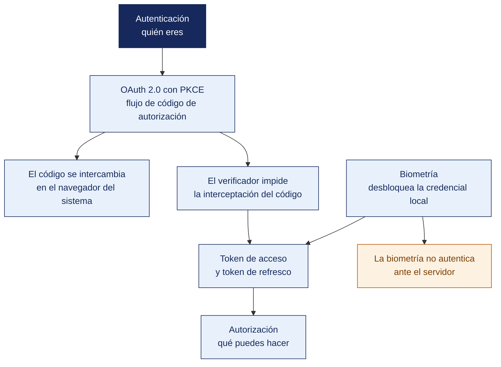

[Semana 11](README.md) · **Teoría** · [Dinámica de aula](2-DINAMICA.md) · [Taller de laboratorio](3-TALLER.md)

# Teoría · Control de Acceso y Autenticación en Apps Móviles

**SI-988 · Soluciones Móviles II** · Semana 11 · Sesión 1 en aula · 2 horas académicas, 100 min, con la dinámica incluida

> ¿Un término no le resulta claro? Está definido en el [glosario técnico del curso](../GLOSARIO.md).

---

## La pregunta de esta sesión

Una app oculta el botón «eliminar» a quien no es administrador. La interfaz funciona y el usuario común nunca lo ve.

El backend no verifica el rol. Cualquiera con un token válido y la dirección del endpoint puede eliminar cualquier registro desde una consola, sin abrir la app siquiera.

> **¿Dónde se decide que un usuario tiene permiso para hacer algo, en el teléfono o en el servidor?**

> **Exploración (5 min), antes de cualquier definición.** El aula responde antes de la teoría y se anota. *¿Está protegida esa función? ¿Sirve de algo ocultar el botón? ¿Puede la huella sustituir a la contraseña?* No se corrige nada todavía.

## Mapa de la sesión



---

## 1. Autenticación y autorización

> **¿Qué separa a quién es de qué puede hacer?**

| | **Autenticación** | **Autorización** |
|---|---|---|
| Pregunta | ¿Quién eres? | ¿Qué puedes hacer? |
| Momento | Al inicio de la sesión | **En cada operación** |
| Dónde se decide | Servidor de identidad | **Servidor de recursos** |
| Error frecuente en móvil | Confiar en el cliente | **Ocultar el botón en la interfaz y no verificar en el servidor** |

> **El error de autorización más común y más grave.** La app oculta la opción «eliminar» a quien no es administrador, y el backend no verifica el rol. **Cualquiera con la API y un token válido puede eliminar.** Ocultar en la interfaz es usabilidad, no seguridad.

**Los tres factores de autenticación.**

| Factor | Qué es | Ejemplo en móvil |
|---|---|---|
| **Algo que sabes** | Conocimiento | Contraseña, PIN |
| **Algo que tienes** | Posesión | El dispositivo, una clave de seguridad, un código temporal |
| **Algo que eres** | Inherencia | Huella, rostro |

**La biometría en móvil no es un factor independiente en el sentido clásico.** Confirma que **quien tiene el dispositivo desbloqueado es su dueño**. Combina posesión e inherencia, y por eso se usa como **desbloqueo local**, no como sustituto de la autenticación en el servidor.

> **El error frecuente del bloque.** Confundir ocultar con proteger. Es el caso de hoy — la app esconde la opción y el servidor no verifica el rol, de modo que **cualquiera con la API y un token válido puede eliminar**. Ocultar en la interfaz es usabilidad; la autorización se comprueba en el servidor, en cada petición.

## 2. OAuth 2.0 y PKCE

> **¿Qué puede guardar en secreto una app cuyo artefacto es descompilable?**

**El problema.** Una app móvil es un **cliente público**. No puede guardar un secreto de cliente, porque su artefacto es descompilable. Los flujos de OAuth diseñados para servidores no le sirven.

**Los flujos y su vigencia.**

| Flujo | Uso en móvil | Estado |
|---|---|---|
| **Código de autorización + PKCE** | Autenticación del usuario | **El correcto y el recomendado** |
| Implícito | Devolvía el token en la URL | **Obsoleto**: el token queda expuesto en el historial y en los registros |
| Credenciales del propietario | La app recibe la contraseña del usuario | **Desaconsejado**: la app nunca debe ver la contraseña |
| Credenciales del cliente | Servicio a servicio | No aplica al usuario |
| Código de dispositivo | Dispositivos sin teclado | Televisores, no teléfonos |

**PKCE — Proof Key for Code Exchange** (RFC 7636). Resuelve el ataque de interceptación del código de autorización:

```
 ① La app genera un verificador aleatorio (43–128 caracteres, generador seguro)
       verificador = base64url(aleatorio_seguro(32 bytes))

 ② Calcula su reto
       reto = base64url(SHA-256(verificador))

 ③ Abre el navegador del SISTEMA con:
       /authorize?client_id=...&redirect_uri=...&code_challenge=<reto>
                 &code_challenge_method=S256&state=<aleatorio>

 ④ El usuario se autentica EN EL NAVEGADOR, no en la app.
    La app NUNCA ve la contraseña.

 ⑤ El servidor redirige a la app con un código de autorización

 ⑥ La app canjea el código enviando el VERIFICADOR original
       POST /token  { code, code_verifier: <verificador>, ... }

 ⑦ El servidor recalcula SHA-256(verificador) y lo compara con el reto guardado.
    Solo coincide para quien inició el flujo.

 → Si otra app interceptó el código en el paso ⑤, no tiene el verificador
   y el canje falla. Ese es el ataque que PKCE previene.
```

**Reglas de implementación.**

| Regla | Por qué |
|---|---|
| **Navegador del sistema**, no una vista web embebida | Una vista web embebida permite a la app leer lo que el usuario escribe; además, no comparte la sesión del navegador |
| **Método S256**, nunca `plain` | `plain` envía el verificador sin transformar y no protege |
| **Parámetro `state` aleatorio y verificado** | Previene la falsificación de petición entre sitios |
| **Redirección con esquema propio o enlace verificado** | El enlace verificado impide que otra app registre el mismo esquema |
| **Sin secreto de cliente** en la app | No puede protegerse en un cliente público |

**Gestión de tokens.**

| Token | Vida útil | Dónde se guarda | Regla |
|---|---|---|---|
| **Acceso** | **Corta.** Minutos a una hora | **Almacén seguro** (Semana 10) | Se envía en cada petición |
| **Renovación** | **Larga.** Días o semanas | **Almacén seguro**, idealmente con exigencia de biometría | Se usa solo para obtener uno nuevo |
| **Identidad** (OIDC) | Corta | Memoria; se valida y se descarta | **Se valida la firma, el emisor, la audiencia y la expiración** |

**Rotación del token de renovación.** Cada uso devuelve uno nuevo e invalida el anterior. Si el servidor recibe dos veces el mismo, **detecta el robo** y revoca toda la familia de tokens.

**Cierre de sesión.** No basta con borrar el token local. Se debe **revocar en el servidor**. Un token borrado del dispositivo pero válido en el servidor sigue sirviendo a quien lo haya copiado.

**Ejemplo trabajado — la misma pantalla de inicio de sesión, en dos implementaciones.** La app debe permitir entrar con la cuenta del usuario y recordar la sesión.

| | **Implementación que un equipo entrega en el sprint 3** | **Implementación correcta** |
|---|---|---|
| Dónde escribe la contraseña | En un formulario **dentro de la app** | En el **navegador del sistema**, mediante código de autorización + PKCE |
| Qué ve la app | Usuario y contraseña en texto claro | Solo un código de autorización, y después el token |
| Flujo OAuth | Credenciales del propietario | Código de autorización con `code_challenge_method=S256` |
| `state` | No se envía | Aleatorio, verificado al volver |
| Redirección | Esquema propio `miapp://` que otra app puede registrar | **Enlace verificado** asociado al dominio del equipo |
| Dónde guarda el token | Preferencias, con vida útil indefinida | Almacén seguro; acceso de 30 min, renovación con rotación |
| «Entrar con huella» | La app compara la huella y, si coincide, **marca la sesión como válida en el cliente** | La biometría desbloquea la clave que descifra el **token de renovación**, y el token se canjea **en el servidor** |
| Cierre de sesión | Borra el token del dispositivo | Borra y **revoca en el servidor** |

**Por qué la fila de la biometría es la que más se falla.** En la columna izquierda, un atacante que modifique la app —o que use un cliente propio— **se salta la comparación por completo**, porque la decisión «sesión válida» se toma en el cliente. En la derecha no hay nada que saltarse. Sin la clave del almacén no hay token de renovación, y sin token el servidor no emite nada.

**Y lo que ocurre cuando el token de renovación se roba, con rotación activada.**

| t | Evento | Respuesta del servidor |
|---|---|---|
| 0 | El usuario legítimo renueva con `RT-1` | Emite `AT-2` y `RT-2`; invalida `RT-1` |
| 1 | El atacante, que copió `RT-1`, intenta renovar | `RT-1` ya fue usado: **detecta reutilización** |
| 2 | — | **Revoca toda la familia**. `RT-2` deja de servir |
| 3 | El usuario legítimo vuelve a abrir la app | Se le pide autenticación completa. Molesto, y correcto. **Es la señal de que hubo un robo** |

> **La pregunta que separa las dos columnas es una sola. ¿Dónde se toma la decisión?** Si «el usuario está autenticado» se decide en el cliente, no hay autenticación. Hay una animación. **El servidor no puede verificar una huella; solo puede verificar un token que él mismo emitió**, y por eso la biometría desbloquea una clave y nunca sustituye al servidor.

> **Microaplicación (6 min). El cierre de sesión de su app.** Cada equipo describe **qué ocurre hoy en su app cuando el usuario cierra sesión**. Si el token solo se borra del dispositivo y no se revoca en el servidor, la sesión sigue viva para quien la haya copiado.

| Caso | Qué debe contener una buena respuesta |
|---|---|
| ¿Por qué el navegador del sistema y no una vista web embebida? | Porque la vista embebida permite a la app leer lo que el usuario escribe —incluida la contraseña— y no comparte la sesión del navegador. El proveedor de identidad además puede rechazarla |
| ¿Para qué sirve `state` si ya existe PKCE? | **Resuelven cosas distintas.** PKCE protege el canje del código; `state` verifica que la respuesta corresponde a la petición que la app inició |
| El usuario cerró sesión y borramos el token. ¿Terminó la sesión? | No, si el token sigue siendo válido en el servidor. Quien lo haya copiado lo sigue usando. El cierre exige revocación en el servidor |

> **El error frecuente del bloque.** Cerrar sesión borrando el token local. Un token borrado del dispositivo pero **válido en el servidor sigue sirviendo a quien lo haya copiado**. El cierre de sesión se completa revocando en el servidor, y la rotación del token de renovación es lo que permite detectar el robo cuando el mismo token se presenta dos veces.

## 3. Qué resuelve y qué no resuelve la biometría

> **¿Puede el servidor verificar una huella?**

**Lo que hay que entender primero.** El sistema **no entrega la huella ni el rostro a la app**. La app pregunta *«¿es el dueño del dispositivo?»* y el sistema responde sí o no. **El dato biométrico nunca sale del hardware seguro.** Por eso la biometría reduce el riesgo en lugar de aumentarlo.

**Los dos usos, y por qué solo uno es correcto.**

| Uso | Descripción | ¿Correcto? |
|---|---|---|
| **Desbloqueo local** | La app ya tiene sesión válida; la biometría desbloquea el acceso local a esa sesión | **Sí.** Es el uso previsto |
| **Sustituto de la autenticación** | La biometría reemplaza la autenticación en el servidor | **No.** El servidor no puede verificar biometría; solo verifica tokens |

**El patrón correcto.**

```
 Primera vez:
   Usuario se autentica con OAuth + PKCE
        → se obtiene el token de renovación
        → se ofrece: «¿Quieres entrar con tu huella la próxima vez?»
        → si acepta: el token de renovación se guarda en el almacén seguro
          con una clave que EXIGE autenticación del usuario

 Siguientes veces:
   La app pide biometría al sistema
        → el sistema confirma
        → la clave del almacén se desbloquea
        → se lee el token de renovación
        → se canjea por un token de acceso nuevo EN EL SERVIDOR
        → sesión iniciada

 → La biometría desbloquea la CLAVE, no autentica ante el servidor.
   La autenticación real sigue ocurriendo en el servidor, con el token.
```

**Los niveles de biometría.** Android clasifica los sensores por su robustez, y la vinculación con el Keystore **solo está disponible para los niveles fuertes**. Un sensor de reconocimiento facial débil puede desbloquear la pantalla pero **no debe usarse para proteger una clave criptográfica**.

**Los casos que hay que manejar** —y que el emulador no reproduce:

| Caso | Comportamiento correcto |
|---|---|
| El dispositivo no tiene sensor | Ofrecer PIN de la app o autenticación completa |
| El usuario no tiene biometría registrada | Ofrecer registrarla, sin bloquear |
| La biometría falla varias veces | El sistema ofrece el respaldo del dispositivo. PIN o patrón |
| **El usuario registra una huella nueva** | **La clave se invalida**. Se detecta y se pide autenticación completa |
| El usuario desactiva la biometría | Volver a la autenticación completa |
| El dispositivo cambia | El almacén no migra: autenticación completa |

> **La invalidación al registrar una biometría nueva es una protección, no un error.** Si alguien registra su huella en el dispositivo ajeno, la clave deja de funcionar. La app debe detectarlo y pedir autenticación completa, no fallar en silencio.

## Cierre

**La respuesta a la pregunta con la que abrimos.** En el servidor, siempre. La pregunta que separa una app segura de una insegura es una sola — **dónde se toma la decisión**. Si «el usuario está autenticado» o «este usuario puede eliminar» se decide en el cliente, no hay seguridad, hay una animación. El servidor no puede verificar una huella; solo puede verificar un token que él mismo emitió.

**Las tres ideas que deben quedar.**

| Idea | Por qué importa en el ejercicio profesional |
|---|---|
| Ocultar en la interfaz es usabilidad, no autorización | La comprobación del rol vive en el servidor y se hace en cada petición |
| Una app móvil es un cliente público y no puede guardar un secreto de cliente | Por eso el flujo vigente es código de autorización con PKCE, en el navegador del sistema |
| La biometría desbloquea una clave local, no autentica ante el servidor | El dato biométrico nunca sale del hardware seguro, y por eso reduce el riesgo en vez de aumentarlo |

**Volviendo a la exploración del inicio.** Se releen las respuestas del inicio. La tercera pregunta se responde casi siempre que sí. La biometría **confirma que quien tiene el dispositivo desbloqueado es su dueño**, y eso desbloquea el token guardado; sin ese token el servidor no emite nada.

**Lo que sigue.** La [dinámica de esta sesión](2-DINAMICA.md) revisa el flujo de autenticación de la app propia y señala dónde se está decidiendo en el cliente. El taller lo corrige después con PKCE y revocación en el servidor.


**Pregunta de cierre.** *si el usuario entra con huella, ¿qué demostró exactamente ante el servidor?* La respuesta —nada; demostró tener el dispositivo desbloqueado, y lo que autentica es el token— es la que evita el error de diseño más frecuente en autenticación móvil.
---

---

[Semana 11](README.md) · **Teoría** · [Dinámica de aula](2-DINAMICA.md) · [Taller de laboratorio](3-TALLER.md)

---

**Docente** · Dr. Oscar Juan Jimenez Flores
[oscarjimenezflores@upt.pe](mailto:oscarjimenezflores@upt.pe) · [LinkedIn](https://www.linkedin.com/in/oscar-jimenez-flores/) · [CTI Vitae — CONCYTEC](https://ctivitae.concytec.gob.pe/appDirectorioCTI/VerDatosInvestigador.do?id_investigador=33398)

Escuela Profesional de Ingeniería de Sistemas · Universidad Privada de Tacna · Tacna, Perú
