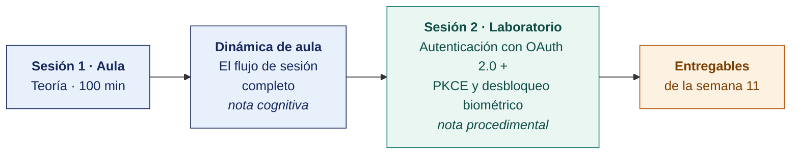

  
  &nbsp;&nbsp;&nbsp;&nbsp;&nbsp;&nbsp;
  

  <strong>Universidad Privada de Tacna</strong> 
  Facultad de Ingeniería · Escuela Profesional de Ingeniería de Sistemas

<h1 align="center">Semana 11 · Control de Acceso y Autenticación en Apps Móviles</h1>

  <strong>SI-988 · Soluciones Móviles II</strong> 
  4 horas académicas de 50 min · 100 min de teoría con la dinámica incluida en aula · 100 min de taller en laboratorio

---

## Datos de la asignatura

| | |
|---|---|
| **Asignatura** | SI-988 · Soluciones Móviles II |
| **Escuela** | Escuela Profesional de Ingeniería de Sistemas |
| **Ciclo** | IX · 04 horas semanales · 04 créditos · Electivo |
| **Prerrequisito** | SI-883 Soluciones Móviles I |
| **Unidad** | II — Geolocalización, seguridad y permisos |
| **Semana** | 11 de 17 |
| **Duración** | 4 horas académicas de 50 min · 100 min de teoría con la dinámica incluida en aula · 100 min de taller en laboratorio |
| **Resultados de aprendizaje** | **RA1** Desarrolla la geolocalización en una app móvil · **RA2** Implementa y gestiona los permisos de geolocalización en una app móvil |
| **Artefacto del proyecto** | **Sprint 4 Planning** · Autenticación con PKCE · Desbloqueo biométrico |

### Lo que indica el sílabo

**Contenido conceptual.** Control de acceso y autenticación en apps móviles.

**Contenido procedimental.** Implementa autenticación en apps móviles (autenticación biométrica).

## Materiales de esta semana

| | Documento | Qué encontrarás | Dónde y cuánto dura |
|---|---|---|---|
| 1 | **[Teoría](1-TEORIA.md)** | Autenticación y autorización · OAuth 2.0 y PKCE · Qué resuelve y qué no resuelve la biometría | Aula · 100 min |
| 2 | **[Dinámica de aula](2-DINAMICA.md)** | El flujo de sesión completo, con su material, su ejemplo resuelto y su rúbrica | Aula · dentro de los 100 min de la sesión de teoría |
| 3 | **[Taller de laboratorio](3-TALLER.md)** | Autenticación con OAuth 2.0 + PKCE y desbloqueo biométrico | Laboratorio · 100 min |

## Ruta de la semana

## Entregables

| Entregable | Formato y nombre del archivo | Vence |
|---|---|---|
| **Dinámica de aula** · El flujo de sesión completo | PDF desde la [plantilla de dinámica](../PLANTILLAS/SI988-PLANTILLA-DINAMICA.docx) · `SI988-S11-DINAMICA-Grupo<N>.pdf` | Según lo programado en el aula virtual |
| **Informe del taller de laboratorio N.º 11** | PDF en formato EPIS desde la [plantilla de taller](../PLANTILLAS/SI988-PLANTILLA-TALLER.docx) · `SI988-S11-TALLER-Grupo<N>.pdf` | Según lo programado en el aula virtual |
| Autenticación con PKCE y biometría | Commit, CI en verde, video de los seis casos | Según lo programado en el aula virtual |

> La dinámica y el informe del taller se entregan en **PDF**, con la carátula de la UPT y los códigos de todos los integrantes. Las plantillas obligatorias están en [`PLANTILLAS/`](../PLANTILLAS/).

## Cómo se evalúa

| Criterio | Instrumento | Peso |
|---|---|---|
| Cognitivo | Rúbrica del flujo de sesión + exposición de 10 min en la Semana 12 | 25 % |
| Procedimental | Lista de cotejo de los 14 resultados del laboratorio | 35 % |
| Actitudinal | Ejecución honesta de las pruebas de autorización y corrección de lo encontrado | 15 % |

## Preparación para la Semana 12

- **Leer.** [Seguridad de red en Android](https://developer.android.com/privacy-and-security/security-config) y [App Transport Security en Apple](https://developer.apple.com/documentation/security/preventing-insecure-network-connections).
- **Leer.** [OWASP MASVS-NETWORK](https://mas.owasp.org/MASVS/) y la guía sobre fijación de certificados.
- Instalar **mitmproxy** y su certificado en el dispositivo de pruebas.
- Preparar el **examen de Unidad II**. Semanas 07 a 12.

---

**Docente** · Dr. Oscar Juan Jimenez Flores
[oscarjimenezflores@upt.pe](mailto:oscarjimenezflores@upt.pe) · [LinkedIn](https://www.linkedin.com/in/oscar-jimenez-flores/) · [CTI Vitae — CONCYTEC](https://ctivitae.concytec.gob.pe/appDirectorioCTI/VerDatosInvestigador.do?id_investigador=33398)

Escuela Profesional de Ingeniería de Sistemas · Universidad Privada de Tacna · Tacna, Perú
