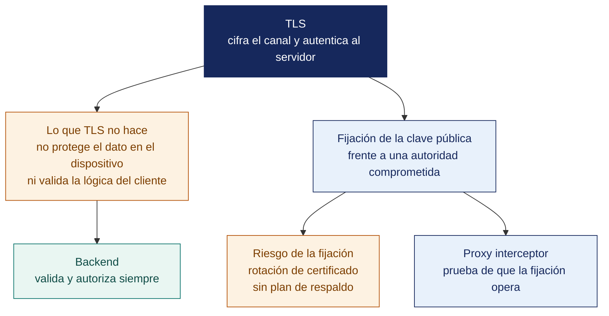

[Semana 12](README.md) · **Teoría** · [Dinámica de aula](2-DINAMICA.md) · [Taller de laboratorio](3-TALLER.md)

# Teoría · Seguridad en Conexiones API · Sprint 4 Review · Examen de Unidad II

**SI-988 · Soluciones Móviles II** · Semana 12 · Sesión 1 en aula · 2 horas académicas, 100 min, con la dinámica incluida

> ¿Un término no le resulta claro? Está definido en el [glosario técnico del curso](../GLOSARIO.md).

---

## La pregunta de esta sesión

Un equipo revisa el tráfico de su app con un proxy interceptor. Instala el certificado del proxy en el dispositivo, abre la app y ve pasar en claro las credenciales, los tokens y los datos del usuario.

TLS funcionó correctamente. El certificado del proxy era de confianza para ese dispositivo, y la app no tenía forma de saber que no hablaba con su servidor.

> **¿Qué garantiza TLS, y qué es exactamente lo que no garantiza?**

> **Autocomprobación, antes de leer el material.** Antes de leer, anote su respuesta a tres preguntas. *¿Falló TLS en ese escenario? ¿Qué defensa lo habría impedido? ¿Qué riesgo trae esa defensa?* Al terminar el material, vuelva a sus respuestas.

## Mapa de la sesión



---

## Material de estudio de la unidad

> **No se dicta en clase.** Los 100 minutos de aula de esta semana se reparten entre la exposición de avance y el examen teórico. Este material —75 minutos de desarrollo— **se estudia por cuenta propia antes de la sesión y entra en el examen teórico de la Unidad II**. Está aquí completo, no resumido. Es el mismo desarrollo que tendría en aula.

### Qué protege TLS y qué no

**Lo que TLS garantiza.**

| Propiedad | Qué significa |
|---|---|
| **Confidencialidad** | Un intermediario no puede leer el contenido |
| **Integridad** | Un intermediario no puede modificarlo sin ser detectado |
| **Autenticación del servidor** | El cliente verifica que habla con quien dice ser |

**Lo que TLS NO garantiza** —y es donde fallan las apps:

| No garantiza | Por qué importa |
|---|---|
| Que el servidor sea **el correcto** | TLS valida que el certificado sea de confianza, no que sea **su** servidor |
| Que el cliente sea legítimo | Cualquiera puede llamar a la API |
| Que el dato esté protegido **en los extremos** | En el servidor y en el dispositivo, el dato está en claro |
| Protección ante un **certificado añadido por el usuario** | Un dispositivo con un certificado instalado permite interceptar el tráfico |

> **El escenario que hay que entender.** Un atacante instala su certificado en el dispositivo, ejecuta un proxy interceptor y **ve todo el tráfico de la app en claro**, incluidos los tokens. **TLS funcionó correctamente.** El certificado del proxy era de confianza **para ese dispositivo**. La defensa es la fijación de certificados.

**La configuración base obligatoria.**

| Plataforma | Configuración | Qué hace |
|---|---|---|
| **Android** | Configuración de seguridad de red | Prohíbe el tráfico en claro, define anclas de confianza y la fijación |
| **iOS** | App Transport Security | Exige TLS con versión y algoritmos mínimos; las excepciones se justifican ante la revisión |

**Reglas mínimas del curso.**

```
· Tráfico en claro: PROHIBIDO en todos los dominios, incluido desarrollo
· TLS 1.2 como mínimo; TLS 1.3 preferido
· Sin excepciones globales de seguridad de transporte
· Los certificados añadidos por el usuario NO se confían en producción
· Toda excepción de desarrollo se limita al dominio local y NO llega al artefacto de release
```

> **El error frecuente.** Dar por segura una conexión porque usa TLS. TLS cifra el canal y valida que el certificado sea de confianza **para ese dispositivo**, y nunca prometió que el interlocutor fuera el servidor del equipo. Un certificado instalado por el atacante cumple las dos cosas.

### Cuándo y cómo fijar certificados

**Qué es.** La app **fija** qué clave pública o qué certificado acepta para su dominio. Aunque un certificado sea de confianza para el sistema, si no coincide con lo fijado, **la conexión se rechaza**.

**Las tres variantes.**

| Variante | Qué se fija | Rotación | Riesgo |
|---|---|---|---|
| **Certificado de hoja** | El certificado del servidor | **Rompe la app al renovar** el certificado | Alto |
| **Clave pública** (recomendado) | El resumen de la clave pública | Sobrevive a la renovación si se conserva la clave | Medio |
| **Certificado intermedio o raíz** | El de la autoridad certificadora | Muy estable | Menor protección |

**La regla que evita el desastre.** Se fijan **al menos dos** valores —el actual y uno de respaldo—, y **se define un plan de rotación antes de activar la fijación**.

> **El riesgo real de la fijación.** Una app publicada con una fijación mal gestionada **deja de funcionar el día que el certificado rota**, y la única solución es que todos los usuarios actualicen. Es el fallo más costoso posible. La app queda inutilizable y no hay corrección del lado del servidor.

**Cuándo se justifica.**

| Caso | ¿Fijar? |
|---|---|
| App bancaria, de pagos o de salud | **Sí**, con respaldo y plan de rotación |
| App que maneja datos personales sensibles | Sí, con la misma cautela |
| App con backend propio y control del certificado | Sí, es viable |
| App que consume APIs de terceros que no controla | **No**: no se controla su rotación |
| Aplicación de un proyecto académico sin infraestructura de rotación | **Se implementa con configuración y fecha de expiración**, y se documenta |

**Alternativas y complementos.**

| Mecanismo | Qué aporta |
|---|---|
| **Attestation de integridad del dispositivo y de la app** | El servidor verifica que la petición proviene de una app legítima en un dispositivo íntegro. **Es más efectivo que la fijación** contra el abuso de la API |
| **Rotación corta de tokens** | Limita el daño si un token se intercepta |
| **Limitación de tasa por usuario y por dispositivo** | Contiene el abuso automatizado |
| **Verificación del origen en el backend** | Cabeceras de aplicación, versión mínima admitida |

**Ejemplo trabajado — la interceptación que TLS no impide, y la fijación que la rompe.** Se conecta el teléfono a un proxy interceptor y se instala su certificado como confiable en el dispositivo.

| Paso | Sin fijación | Con fijación de clave pública |
|---|---|---|
| La app abre la conexión a `api.miapp.pe` | El proxy presenta **su** certificado, emitido por la autoridad que el usuario instaló | Igual |
| El sistema valida el certificado | **Válido**: la autoridad está en el almacén de confianza del dispositivo | **Válido** también |
| La app compara con lo fijado | No compara nada | El resumen de la clave pública **no coincide** |
| Resultado | La conexión se establece | **La conexión se rechaza** |
| Lo que ve el atacante | Token, correo, pedidos y respuestas **en claro** | Nada |

**TLS hizo su trabajo en ambas columnas.** Validó que el certificado fuera de confianza *para ese dispositivo*; nunca prometió que fuera **el servidor del equipo**. Esa segunda comprobación es exactamente lo que agrega la fijación.

**Y el precio de equivocarse al fijar.** El mismo equipo publica con fijación del **certificado de hoja**, sin respaldo:

| Momento | Qué pasa |
|---|---|
| Mes 1 | Todo funciona |
| Mes 4 | El certificado del servidor se renueva automáticamente, con **clave nueva** |
| Mes 4, minuto siguiente | **Todas las instalaciones dejan de conectar.** La app muestra error de red y nada más |
| Corrección | No hay arreglo del lado del servidor. Hay que publicar una versión y **esperar que cada usuario actualice** |
| Tiempo real hasta recuperar al 90 % de los usuarios | Días, y en las tiendas la revisión añade su propio plazo |

> **La fijación es la única defensa contra la interceptación con certificado instalado, y también el único fallo del curso que no se puede corregir desde el servidor.** Por eso la regla es de tres partes y ninguna es opcional. **Fijar la clave pública** —no el certificado—, **fijar al menos dos valores** (el actual y el de respaldo) y **escribir el plan de rotación antes de activarla**. Un equipo que no puede sostener esas tres cosas está más seguro sin fijación.

> **Autoevaluación (6 min). El tráfico de su propia app.** Escriba **qué vería un interceptor en el tráfico de su app hoy** y cuál de esos datos no debería estar viajando. La lista suele ser más larga de lo que el equipo espera.

| Caso | Qué debe contener una buena respuesta |
|---|---|
| Si el certificado del proxy es válido, ¿falló TLS? | No. TLS garantiza confidencialidad, integridad y que el certificado sea de confianza **para ese dispositivo**. Que sea el servidor correcto lo decide la fijación |
| ¿Se fija contra una API de terceros? | No. No se controla su calendario de rotación, y el día que renueven la app queda rota sin aviso |
| ¿Qué defensa protege mejor la API que la fijación? | La attestation de integridad de app y dispositivo verificada en el servidor, sumada a rotación corta de tokens y limitación de tasa. No dependen de una publicación en las tiendas para corregirse |

> **El error frecuente.** Activar la fijación sin plan de rotación. Es el único fallo del curso que **no se puede corregir desde el servidor** — la app publicada deja de funcionar el día que el certificado rota y solo se arregla si todos los usuarios actualizan. La regla es de tres partes y ninguna es opcional. Fijar la clave pública, fijar al menos dos valores y escribir el plan de rotación antes de activarla.

### Proteger el backend, no solo el canal

**La premisa de la Semana 10 aplicada a la API.** Cualquiera puede llamar a la API con las credenciales extraídas del artefacto. **El backend debe protegerse como si todas sus peticiones vinieran de un atacante.**

| Control del backend | Qué previene |
|---|---|
| **Validación de toda entrada** | Inyección, desbordamiento, datos inconsistentes |
| **Autorización por recurso**, no por rol global | Acceso a datos ajenos |
| **Limitación de tasa** por usuario, dispositivo e IP | Abuso, fuerza bruta, extracción masiva |
| **Paginación con límite máximo** | Extracción de toda la base en una petición |
| **Ausencia de detalles técnicos en los errores** | Filtración de la estructura interna |
| **Registro de auditoría** de operaciones sensibles | Investigación tras un incidente |
| **Versión mínima de app admitida** | Forzar la actualización ante una vulnerabilidad corregida |
| **Cabeceras de seguridad** en las respuestas | Defensa en profundidad |

> **El control más olvidado es el límite máximo de paginación.** Una API que acepta `?limit=1000000` permite descargar la base completa con una sola petición autenticada. El límite debe imponerlo el servidor, no confiar en que el cliente pida poco.

**Ejemplo trabajado — la misma API, atacada con un token legítimo.** El atacante es un usuario real — se registró, obtuvo su token y ahora llama a la API con un cliente propio. Ningún control del canal lo detiene, porque no está interceptando nada.

| Petición del atacante | Backend sin controles | Backend con controles |
|---|---|---|
| `GET /pedidos?limit=1000000` | Devuelve **la base completa de pedidos** en una respuesta | El servidor impone `limit` máximo de 50; devuelve 50 |
| `GET /pedidos/8842` *(pedido de otro usuario)* | **Devuelve el pedido.** Solo se verificó que el token fuera válido | **403**: la autorización se comprueba **por recurso**, no por rol global |
| `DELETE /locales/17` *(el botón está oculto en la app)* | **Elimina el local**. El backend nunca verificó el rol | 403: el rol se verifica en el servidor |
| 4 000 `POST /login` en un minuto | Fuerza bruta sin obstáculo | **429** tras el umbral, por usuario, dispositivo e IP |
| `GET /pedidos?orden=;DROP…` | El error devuelve la consulta y el nombre de la tabla | Entrada validada; el error no revela nada interno |
| Petición desde una versión con vulnerabilidad ya corregida | Se atiende igual | Se rechaza por **versión mínima admitida** y se pide actualizar |

> **Los seis ataques usan un token válido, TLS correcto y, en cuatro de los seis, una petición que la app jamás enviaría.** Ese es el punto de toda la unidad — **la app es una de las formas de llamar a la API, no la única**, y ocultar un botón, validar en el cliente o limitar el `limit` desde la app no protege nada. **Todo control que importa se verifica en el servidor, porque es lo único que el atacante no controla.**

> **Autoevaluación (6 min). La comprobación que falta en el servidor.** Señale **un endpoint de su app en el que el servidor no verifica el rol** y escriba la comprobación que le falta. Si no encuentra ninguno, revise los de borrado y los de edición ajena.

| Caso | Qué debe contener una buena respuesta |
|---|---|
| El botón «eliminar» solo lo ve el administrador. ¿Es suficiente? | No. Ocultarlo es usabilidad. Sin verificación de rol en el servidor, cualquiera con un token válido ejecuta la operación |
| ¿Por qué el límite de paginación lo impone el servidor? | Porque el cliente puede pedir lo que quiera. Una API que respeta `?limit=1000000` entrega la base completa con una sola petición autenticada |
| ¿Para qué sirve declarar una versión mínima de app? | Para forzar la actualización cuando se corrige una vulnerabilidad. Sin ella, las instalaciones antiguas siguen expuestas indefinidamente |

---

## Exposición de avance de la Unidad II

Cada equipo expone el avance de su producto ante el aula y el docente. **6 minutos por equipo**, 10 equipos, sin margen. Se corta al minuto seis.

| Momento | Duración | Qué se muestra |
|---|---|---|
| Qué se propuso el equipo para esta unidad | 1 min | El objetivo declarado al inicio de la unidad |
| **Lo construido, funcionando** | 3 min | Producto real, no diapositivas de lo que se piensa hacer |
| Lo que no se logró y por qué | 1 min | Con honestidad. Ocultarlo cuesta más que declararlo |
| Preguntas | 1 min | Del docente |

> **Se evalúa el avance verificable, no la presentación.** Un equipo que muestra poco pero real puntúa por encima de uno que muestra mucho y no lo tiene.

## Examen de Unidad II

El Examen de Unidad se rinde en dos partes, y juntas valen el 25 % de la nota de la unidad.

| Parte | Dónde y cuándo | Duración | Qué evalúa | Materiales |
|---|---|---|---|---|
| **Teórico** | Aula, al cierre de esta sesión | 40 min | Preguntas de alternativas sobre las Semanas 07 a 12, incluido el material de estudio de esta semana | Apuntes propios. **Sin** internet ni asistentes de inteligencia artificial |
| **Práctico** | Laboratorio | 100 min | Leer una app como la leería un atacante y como la leería la autoridad de protección de datos | Laboratorio de cómputo, **con inteligencia artificial permitida** y declarada |


## Cierre

**La respuesta a la pregunta del material.** TLS garantiza que el canal está cifrado y que el certificado es de confianza **para ese dispositivo**. No garantiza que el interlocutor sea su servidor, y esa segunda comprobación es exactamente lo que agrega la fijación de certificados. En el caso del proxy, TLS hizo su trabajo entero y aun así el tráfico se leyó en claro.

**Las tres ideas que deben quedar.**

| Idea | Por qué importa en el ejercicio profesional |
|---|---|
| TLS protege el canal y no identifica al interlocutor como suyo | Un certificado instalado en el dispositivo por el atacante es de confianza para ese dispositivo |
| La fijación es la única defensa contra la interceptación con certificado instalado | Y también el único fallo que no admite corrección desde el servidor |
| El canal seguro no sustituye a la protección del backend | La autorización, los límites de tasa y la validación de entrada viven en el servidor, no en el cliente |

**Lo que sigue.** Con esto cierra la Unidad II. La Unidad III construye lo que falta para publicar — frameworks, interfaces adaptativas, pruebas y el envío a las dos tiendas, donde **un descuido de fijación deja la app inutilizable sin vuelta atrás**.

---

---

[Semana 12](README.md) · **Teoría** · [Dinámica de aula](2-DINAMICA.md) · [Taller de laboratorio](3-TALLER.md)

---

**Docente** · Dr. Oscar Juan Jimenez Flores
[oscarjimenezflores@upt.pe](mailto:oscarjimenezflores@upt.pe) · [LinkedIn](https://www.linkedin.com/in/oscar-jimenez-flores/) · [CTI Vitae — CONCYTEC](https://ctivitae.concytec.gob.pe/appDirectorioCTI/VerDatosInvestigador.do?id_investigador=33398)

Escuela Profesional de Ingeniería de Sistemas · Universidad Privada de Tacna · Tacna, Perú
