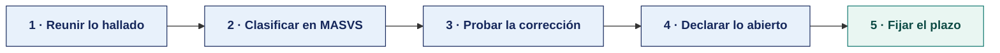

[Semana 12](README.md) · [Teoría](1-TEORIA.md) · **Dinámica de aula** · [Taller de laboratorio](3-TALLER.md)

# Dinámica de aula · El informe de seguridad de nuestra app

**SI-988 · Soluciones Móviles II** · Semana 12 · **Trabajo previo a la sesión** · calificación **cognitiva**

> ¿Un término no le resulta claro? Está definido en el [glosario técnico del curso](../GLOSARIO.md).

---

> **Esta actividad no se resuelve en aula.** La semana de cierre de unidad dedica el aula a la **exposición de avance** y al **examen teórico**. La dinámica se prepara durante la semana y **se entrega antes de la sesión**. Es el insumo con el que el equipo arma su exposición.

## Qué entregas

| | |
|---|---|
| **Archivo** | `SI988-S12-DINAMICA-Grupo<N>.pdf` |
| **Plantilla obligatoria** | [SI988-PLANTILLA-DINAMICA.docx](../PLANTILLAS/SI988-PLANTILLA-DINAMICA.docx) |
| **Formato** | PDF exportado desde la plantilla en Word, con la carátula de la UPT y los apellidos, nombres y códigos de todos los integrantes |
| **Qué va dentro** | El producto de cierre de unidad que se describe más abajo, desarrollado por el grupo con la evidencia acumulada en la unidad |
| **Dónde se sube** | Aula virtual, tarea «Dinámica · Semana 12» |
| **Cuándo vence** | Según lo programado en el aula virtual, antes del examen de la unidad |
| **Exposición** | En la **exposición de avance de la unidad**, dentro de esta misma sesión. El grupo lee y explica su resultado ante el aula. No se usan diapositivas |

> No se califica un trabajo entregado en `.docx`, sin carátula, sin los códigos de los integrantes o con las tablas del producto vacías.

---

| Componente | Peso |
|---|---|
| Exposición de la Semana 11 | 30 % |
| **Examen de Unidad II** | 70 % |

---

## Consigna

> **«El informe de seguridad de nuestra app»**
> Un producto por equipo con los **cinco hallazgos de seguridad** encontrados en su propia aplicación durante la Unidad II, su categoría MASVS, si están corregidos y **el que aún no lo está, con la razón**.

| | |
|---|---|
| **Su papel** | **El equipo responde por su propia app** ante quien va a instalarla |
| **Misión** | Presentar los cinco hallazgos con su categoría, su estado y la evidencia de la corrección |
| **Restricción** | **Hay que declarar el que sigue abierto.** Un informe donde los cinco están corregidos y ninguno documentado se lee como que no se buscó |

Que el equipo mire su propia aplicación con los ojos con los que miró la app vulnerable de la Semana 10. Encontrar un fallo propio y declararlo abierto vale más que un informe impecable sin evidencia.

## Cómo se prepara

**Paso 1 · Reunir lo hallado.** Todo lo que salió en las Semanas 09 a 12 sobre la propia app — auditoría de almacenamiento, verificación MASVS, tráfico interceptado y análisis de dependencias.

**Paso 2 · Clasificar en MASVS.** Cada hallazgo a su categoría. Si dos caen en la misma, se elige el de mayor impacto y se descarta el otro, para que los cinco no sean el mismo problema repetido.

**Paso 3 · Probar la corrección.** Un hallazgo corregido necesita el antes y el después. La captura del código corregido no basta. Hace falta la salida del comando que antes lo revelaba y ahora no.

**Paso 4 · Declarar lo abierto.** Al menos uno queda sin corregir, y se dice por qué —no se supo, no dio tiempo o se decidió asumirlo— y qué expone mientras siga así.

**Paso 5 · Fijar el plazo.** Para el hallazgo abierto, en qué sprint se cierra y quién lo verifica.

## Producto

**Un solo producto**, que va en la sección 2 de la plantilla, «El producto».

| Campo | Contenido |
|---|---|
| Hallazgo | Qué se encontró, en una oración, sobre la propia app |
| Categoría MASVS | La categoría con su código, una distinta por hallazgo |
| Qué expone | Qué obtiene quien lo aprovecha, en términos del usuario y no del sistema |
| Estado | Corregido, con la evidencia del antes y del después; o **abierto**, con su razón |
| Plazo | Solo para los abiertos. En qué sprint se cierra y quién lo verifica |

**Cinco filas, cinco categorías distintas, y al menos una abierta.**

> **Dónde va.** Este producto se presenta en la **sección 2 de la [plantilla de dinámica](../PLANTILLAS/SI988-PLANTILLA-DINAMICA.docx)**, «El producto». No se copia la consigna ni la teoría. Solo el resultado y lo que lo sostiene.

## Ejemplo resuelto

*El caso de este ejemplo es distinto del que le toca a tu grupo. Sirve para que veas el nivel de detalle que se espera, no para copiarlo.*

**Un informe de seguridad bien resuelto.** La app del ejemplo es de un ciclo anterior.

| # | Hallazgo | **Categoría MASVS** | ¿Corregido? | Evidencia |
|---|---|---|---|---|
| 1 | El token de sesión se guardaba en preferencias compartidas sin cifrar | MASVS-STORAGE | **Sí** | Migrado al almacén de claves del sistema. Verificado extrayendo el artefacto de depuración. El archivo `session.xml` ya no existe |
| 2 | La clave del proveedor de mapas estaba en `strings.xml` | MASVS-STORAGE | **Sí** | Las peticiones pasan por el backend propio. La clave anterior fue rotada y revocada |
| 3 | Tráfico hacia el servicio de análisis en texto claro | MASVS-NETWORK | **Sí** | Excepción de texto claro eliminada de la configuración de red. **Capturado con proxy.** Todo el tráfico es HTTPS |
| 4 | Sin fijación de certificado en el endpoint de autenticación | MASVS-NETWORK | **Sí** | Fijación de clave pública con respaldo de una segunda clave, y prueba con proxy interceptor que confirma el rechazo de la conexión |
| 5 | El identificador de usuario viaja en la URL como parámetro de consulta y queda en los registros del servidor | MASVS-PRIVACY | **No** | Ver abajo |

> **El que aún no está corregido y por qué.** El hallazgo 5 exige cambiar la ruta de tres endpoints del backend, que consume también el panel administrativo del equipo del cliente. Cambiar la ruta sin coordinar rompería ese panel. Está registrado como deuda técnica **DT-11**, con la corrección planificada para el Sprint 5 y una medida provisional ya aplicada. El servidor deja de escribir la URL completa en el registro de acceso, así que el identificador ya no se persiste.

**Por qué declarar un hallazgo sin corregir puntúa más que ocultarlo.** Un informe que declara cinco hallazgos y cinco corregidos, sin evidencia, no es creíble. Uno que declara cuatro corregidos con evidencia y explica por qué el quinto sigue abierto, con plazo y medida provisional, es exactamente lo que se espera de un informe profesional.

**La diferencia entre aprobar y no aprobar.**

| Así no | Así sí |
|---|---|
| «Corregimos todos los hallazgos de seguridad.» | «Cuatro corregidos con evidencia verificable. El quinto sigue abierto: DT-11, Sprint 5, con medida provisional aplicada.» |
| «Categoría: almacenamiento.» | «MASVS-STORAGE.» |
| «Se movió el token a un lugar seguro.» | «Migrado al almacén de claves del sistema. Verificado extrayendo el artefacto: `session.xml` ya no existe.» |

## Reglas

- No se resuelve en aula. Se prepara durante la semana y **se entrega antes de la sesión**.
- Los cinco hallazgos son de la **propia aplicación**, no de la app vulnerable de la Semana 10.
- **Cinco categorías MASVS distintas.** El mismo problema repetido cuenta como uno.
- Todo hallazgo corregido lleva la salida del comando antes y después. Sin eso se considera no corregido.
- La exposición es la ronda de avance de la unidad. El grupo **lee y explica su resultado**. No se usan diapositivas.

## Rúbrica cognitiva (20 puntos)

Se aplica sobre el informe de seguridad de cierre de unidad y sobre la exposición de avance.

| Criterio | 5 | 3 | 1 |
|---|---|---|---|
| **Los hallazgos** | Los cinco encontrados en la propia aplicación, cada uno con su categoría MASVS y su ubicación | Tres o cuatro con su categoría | Hallazgos copiados de una lista, no encontrados |
| **El impacto** | Cada hallazgo dice qué permitiría hacer a un atacante en esta aplicación concreta | El impacto se enuncia en general | Se declara la severidad sin justificarla |
| **La corrección** | Aplicadas y verificadas en el repositorio, con su Pull Request | Aplicadas sin verificación | Solo propuestas |
| **La exposición de avance** | Todo el equipo domina el informe y responde sin buscar quién sabe | Responde siempre el mismo integrante | El equipo no puede explicar sus propios hallazgos |

## Anexo · Material de trabajo

**Este producto no se resuelve en aula y no necesita material nuevo.** Se construye con lo que el equipo ya produjo en las Semanas 09 a 12 sobre su propia aplicación.

| Para qué | De dónde sale |
|---|---|
| Los hallazgos | `AUDITORIA_ALMACENAMIENTO.csv`, `VERIFICACION_MASVS.csv` y la tabla de MASVS-NETWORK |
| La evidencia del antes | `INTERCEPCION_ANTES.md`, las salidas de `strings` y los reportes de MobSF |
| La evidencia del después | `INTERCEPCION_DESPUES.md`, la extracción repetida y las ejecuciones de la integración continua |
| Lo que quedó abierto | Los controles MASVS marcados como no verificados y el registro de dependencias vulnerables |

---

[Semana 12](README.md) · [Teoría](1-TEORIA.md) · **Dinámica de aula** · [Taller de laboratorio](3-TALLER.md)

---

**Docente** · Dr. Oscar Juan Jimenez Flores
[oscarjimenezflores@upt.pe](mailto:oscarjimenezflores@upt.pe) · [LinkedIn](https://www.linkedin.com/in/oscar-jimenez-flores/) · [CTI Vitae — CONCYTEC](https://ctivitae.concytec.gob.pe/appDirectorioCTI/VerDatosInvestigador.do?id_investigador=33398)

Escuela Profesional de Ingeniería de Sistemas · Universidad Privada de Tacna · Tacna, Perú
