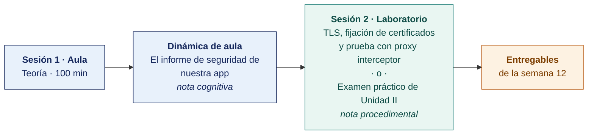

  
  &nbsp;&nbsp;&nbsp;&nbsp;&nbsp;&nbsp;
  

  <strong>Universidad Privada de Tacna</strong> 
  Facultad de Ingeniería · Escuela Profesional de Ingeniería de Sistemas

<h1 align="center">Semana 12 · Seguridad en Conexiones API · Sprint 4 Review · Examen de Unidad II</h1>

  <strong>SI-988 · Soluciones Móviles II</strong> 
  4 horas académicas de 50 min · 100 min de exposiciones y examen de unidad en aula · 100 min de taller en laboratorio

---

## Datos de la asignatura

| | |
|---|---|
| **Asignatura** | SI-988 · Soluciones Móviles II |
| **Escuela** | Escuela Profesional de Ingeniería de Sistemas |
| **Ciclo** | IX · 04 horas semanales · 04 créditos · Electivo |
| **Prerrequisito** | SI-883 Soluciones Móviles I |
| **Unidad** | II — Geolocalización, seguridad y permisos (cierre) |
| **Semana** | 12 de 17 |
| **Duración** | 4 horas académicas de 50 min · 100 min de exposiciones y examen de unidad en aula · 100 min en laboratorio, compartidos entre el taller y el examen práctico |
| **Resultados de aprendizaje** | **RA1** Desarrolla la geolocalización en una app móvil · **RA2** Implementa y gestiona los permisos de geolocalización en una app móvil |
| **Artefacto del proyecto** | **Sprint 4 Review y Retrospective** · Conexiones aseguradas y verificadas |

### Lo que indica el sílabo

**Contenido conceptual.** Seguridad en conexiones API. Examen de Unidad.

**Contenido procedimental.** Implementa medidas de seguridad en las conexiones API (HTTPS, certificados). Resuelve su examen de unidad.

## Materiales de esta semana

| | Documento | Qué encontrarás | Dónde y cuánto dura |
|---|---|---|---|
| 1 | **[Teoría](1-TEORIA.md)** | Qué protege TLS y qué no protege · Fijación de certificados · Proteger el backend, no solo el canal | Aula · 100 min |
| 2 | **[Dinámica de aula](2-DINAMICA.md)** | El informe de seguridad de nuestra app, con su material, su ejemplo resuelto y su rúbrica | **Trabajo previo**, se entrega antes de la sesión |
| 3 | **[Taller de laboratorio](3-TALLER.md)** | TLS, fijación de certificados y prueba con proxy interceptor | Laboratorio · 100 min · **comparte sesión con el examen práctico** |

> **El laboratorio de esta semana lo reclaman dos documentos y solo caben los 100 minutos de una sesión.** El **examen práctico** y el **[taller](3-TALLER.md)** están escritos completos y son independientes entre sí. El docente publica en el aula virtual el que ocupará la sesión y deja el otro como trabajo fuera de ella, y lo comunica al inicio de la semana. **El plazo no cambia con esa decisión** — ambos vencen contando desde la sesión de laboratorio, que se dicta igual en cualquiera de los dos casos.

## Ruta de la semana

## Entregables

| Entregable | Formato y nombre del archivo | Vence |
|---|---|---|
| **Dinámica de aula** · El informe de seguridad de nuestra app | PDF desde la [plantilla de dinámica](../PLANTILLAS/SI988-PLANTILLA-DINAMICA.docx) · `SI988-S12-DINAMICA-Grupo<N>.pdf` | Según lo programado en el aula virtual |
| **Informe del taller de laboratorio N.º 12** | PDF en formato EPIS desde la [plantilla de taller](../PLANTILLAS/SI988-PLANTILLA-TALLER.docx) · `SI988-S12-TALLER-Grupo<N>.pdf` | Según lo programado en el aula virtual |
| **Examen teórico de Unidad II** | Presencial, 40 min, Preguntas de alternativas | Sesión de aula |
| **Examen práctico de Unidad II** | 100 min, individual, con inteligencia artificial permitida y declarada | Sesión de laboratorio, si el docente le asigna la sesión |
| **Incremento del Sprint 4**, Review y Retrospective | Repositorio con la etiqueta `sprint-4` | Según lo programado en el aula virtual |

> La dinámica y el informe del taller se entregan en **PDF**, con la carátula de la UPT y los códigos de todos los integrantes. Las plantillas obligatorias están en [`PLANTILLAS/`](../PLANTILLAS/).

## Cómo se evalúa

| Criterio | Instrumento | Peso en la unidad |
|---|---|---|
| Actitudinal | Participación, Dailies, cumplimiento de los acuerdos y **manejo ético de las herramientas de interceptación** en las semanas 07–12 | 15 % |
| Cognitivo | Promedio de las rúbricas de las dinámicas S07–S11 + «El informe de seguridad» | 25 % |
| Procedimental | Promedio de las listas de cotejo de los laboratorios 07–12 + **calidad del incremento de los Sprints 2, 3 y 4** | 35 % |
| Examen de Unidad | **Teórico** en aula, 40 min, Preguntas de alternativas · **Práctico** en laboratorio, 100 min, con inteligencia artificial permitida | 25 % |
| | **La Unidad II aporta el 35 % de la nota final del curso** | |

## Preparación para la Unidad III

La Unidad III cierra el producto y lo **publica en ambas tiendas**.

- **Verificar hoy** que el equipo tiene o puede obtener. Cuenta de Google Play Console y membresía del Apple Developer Program. **Si falta alguna, se resuelve esta semana.**
- **Recordatorio crítico.** Las cuentas personales de Google Play creadas después del 13 de noviembre de 2023 requieren **12 testers con opt-in continuo durante 14 días** antes de solicitar producción. **La prueba cerrada se inicia en la Semana 14.** Empezar a reclutar testers **ahora**.
- **Leer.** Documentación de los frameworks multiplataforma para la evaluación de la Semana 13.
- **Planificar el Sprint 5**, que es el último. Debe cerrar el producto.

---

**Docente** · Dr. Oscar Juan Jimenez Flores
[oscarjimenezflores@upt.pe](mailto:oscarjimenezflores@upt.pe) · [LinkedIn](https://www.linkedin.com/in/oscar-jimenez-flores/) · [CTI Vitae — CONCYTEC](https://ctivitae.concytec.gob.pe/appDirectorioCTI/VerDatosInvestigador.do?id_investigador=33398)

Escuela Profesional de Ingeniería de Sistemas · Universidad Privada de Tacna · Tacna, Perú
